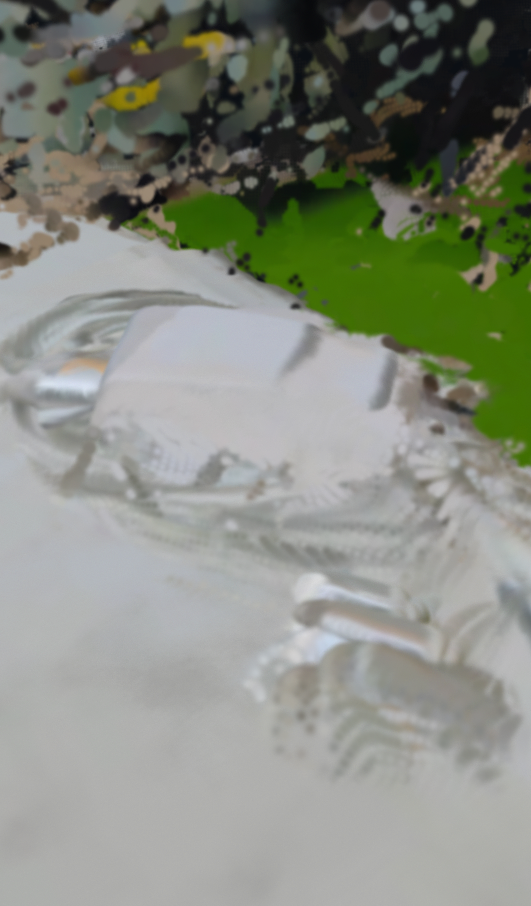

# 책상 위 충전기 3D

폰으로 찍은 21초 영상 하나에서 만든 3차원 장면(가우시안 스플랫)을 웹에서 돌려 볼 수 있게 한 것입니다.

- 보기: https://kwkworks.github.io/my-open-space/
- 저장소: https://github.com/kwkworks/my-open-space
- 장면 파일: `scene.sog` (13.86MB, 알갱이 3,077,620개)

## 1. 어떤 공간이고 왜 공개해도 되는가

내 소유의 접이식 책상 위에 놓은 충전기와 케이블을 골랐습니다. 촬영자(본인) 소유의 물건이고 공개를 허락했습니다. 촬영 범위에는 사람과 얼굴, 간판, 문패가 없고 책상 위쪽 가장자리에 인쇄된 종이 서류가 한 장 보이지만, 3D 결과에서는 글자가 읽히지 않는 흰 얼룩으로만 나옵니다(모델이 사진을 518×294로 줄여 처리하기 때문). 원본 영상과 추출한 사진은 이 저장소에 올리지 않았습니다.

## 2. 촬영

| 항목 | 값 |
|---|---|
| 대상 | 책상 위 충전기와 케이블 |
| 경로 | 책상 둘레를 호를 그리며 천천히 이동 (한 자리에서 몸만 돌리지 않음) |
| 영상 | 21.0초, 1080×1920 (세로) |
| 추출한 프레임 | 24장 (영상 길이에 맞춰 약 0.88초 간격, 긴 변 1280으로 축소) |
| 복원 모델 | `facebook/map-anything-apache`, T4 GPU, fp16 |

세로로 찍어서 배경이 좁게 잡힌 점은 한계입니다.

## 3. 복원과 카메라 퍼짐

| 항목 | 값 |
|---|---|
| 모델 입력 크기 | 518×294 |
| 복원 시간 / 최대 GPU 메모리 | 10.8초 / 6.74GB |
| 점 개수 | 3,165,782개 → 멀리 튄 점 제거(각 축 0.5~99.5 백분위 밖) 후 3,077,620개 |
| 카메라 상자 대각선 / 장면 상자 대각선 | 1.386 / 4.636 |
| **카메라 퍼짐 비** | **0.299** (0.1보다 큼) |

퍼짐 비는 보조 값이라 이것만으로 판단하지 않았습니다. 카메라 24대의 위치를 장면 점구름과 함께 그려 보니 1번부터 24번까지 호를 그리며 이어지고, 모두 가운데 책상 쪽을 바라봅니다. 실제로 책상 둘레를 걸으며 찍은 경로와 같은 모양입니다.

## 4. 알갱이 만들기

점의 위치와 색에서 출발해 알갱이당 17개 값(위치 3, 법선 3, 기본 색 3, 불투명도 1, 크기 3, 회전 4)을 저장했습니다. 방향에 따른 색 계수는 넣지 않았습니다. 반지름은 `K × 장면의 가장 긴 변 ÷ √N`으로 정했고, K를 0.8, 1.0, 1.4, 2.2로 바꿔 같은 위치에서 눈으로 비교한 뒤 **K=1.0**으로 확정했습니다(반지름 0.00192).

| K | 눈으로 본 결과 |
|---|---|
| 0.8 | 충전기 단자와 케이블 결이 또렷하고 배경에 작은 구멍이 많음 |
| **1.0** | 0.8만큼 선명하면서 구멍이 줄어듦 (선택) |
| 1.4 | 구멍은 거의 없지만 전체가 부드럽게 번짐 |
| 2.2 | 형태를 알아보기 어려울 만큼 뭉개짐 |

화질 수치(PSNR, SSIM, LPIPS)는 평가용 사진을 따로 빼 두지 않아 만들지 않았습니다.

## 5. 형식별 크기 비교

같은 `scene.ply`(K=1.0)를 `splat-transform@3.10.3`으로 변환했습니다. 변환 시간은 `npx` 시작 시간을 포함한 값입니다.

| 형식 | 크기 (바이트) | MiB | 변환 시간 | 알갱이 수 | 알갱이당 바이트 |
|---|---|---|---|---|---|
| `.ply` (원본) | 209,278,577 | 199.6 | (생성 1.9초) | 3,077,620 | 68.0 |
| `.compressed.ply` | 50,108,166 | 47.8 | 8.9초 | 3,077,620 | 16.3 |
| `.spz` | 17,102,596 | 16.3 | 10.3초 | 3,077,620 | 5.6 |
| **`.sog`** | **13,857,611** | **13.2** | 10.3초 | 3,077,620 | **4.5** |

알갱이 수는 모두 같습니다. 형식을 바꿔도 그릴 알갱이 양은 변하지 않았고, 저장된 파일 크기만 달라졌습니다. 세 형식 모두 뷰어(Spark 2.4.0)에서 열렸습니다. 원본 PLY는 GitHub 100MiB 한도를 넘어 올리지 않았고, 가장 작고 풀기도 빠른 `.sog`를 공개용으로 골랐습니다. 크기는 1,048,576으로 나눈 MiB와 1,000,000으로 나눈 MB를 구분해 적었습니다.

## 6. 첫 화면까지 걸린 시간

| 기기 / 환경 | 첫 화면까지 | 비고 |
|---|---|---|
| 내 컴퓨터 (로컬 서버) | 파일 받기 약 0.1초, 알갱이 풀기 약 1.2~1.5초 | 인터넷을 거치지 않아 참고용 |
| 내 컴퓨터 (공개 Pages 주소, 데스크톱 브라우저) | 파일 받기 5.7초, 알갱이 풀기 1.8초 (합계 약 7.5초) | 2026-11-13 한 번 측정, 통신 환경은 기록하지 않음 |
| 갤럭시 S26 울트라 (5G/LTE 모바일 데이터) | **약 10초** (화면이 뜰 때까지, 손으로 잰 대략값) | 2026-11-13. 화면을 돌릴 때의 끊김은 기록하지 않음 |
| 갤럭시 S25 | 약 7.5초 (화면이 뜰 때까지), 장면이 잘 보임 | 2026-11-13. 내 폰(S26 울트라와는 다른 기기). 통신 환경은 기록하지 않음 |
| 다른 사람의 폰 | **측정 전** | 위 두 대는 모두 내 폰이라 링크를 받은 다른 사람의 기기에서는 아직 확인하지 못함 |

## 7. 잘 보이는 방향과 한계

- **잘 보이는 방향:** 촬영한 호(1~24번 카메라 위치) 안쪽에서 충전기 쪽을 볼 때입니다. 책상 윗면과 충전기, 뒤쪽 녹색 매트가 바로 서서 보입니다.
- **구멍과 잡티:** 촬영 호 바깥쪽으로 돌아가면 점이 없는 면이 드러나고, 책상 아래와 뒷면은 비어 보입니다. 원본 영상에 한 번도 찍히지 않은 면이라 알갱이 크기를 키워도 채워지지 않습니다. 이는 시차를 만들 시점이 없어 깊이를 풀 수 없었다는 뜻입니다.
- **배경의 얼룩:** 책상 뒤 짐과 바닥에 얼룩덜룩한 덩어리가 보입니다. 멀리 있는 배경은 시점 변화에 따른 움직임이 작아 깊이 추정이 흔들리고, 사진마다 점이 서로 어긋나게 정렬되어 번진 것으로 보입니다.
- **충전기 케이블이 겹쳐 보임:** 가는 케이블이 두 겹으로 어른거립니다. 모델 입력이 518×294로 줄어들어 가는 물체가 뭉개지고, 사진 사이 정렬이 조금씩 어긋난 탓으로 보입니다. 알갱이 크기 문제가 아니라 K를 바꿔도 남았습니다.
- **원인은 눈으로 본 추정입니다.** 각 원인을 따로 실험으로 가려내지는 않았습니다.

## 파일

| 파일 | 설명 |
|---|---|
| `index.html` | three.js 0.180.0 + Spark 2.4.0 뷰어. `.sog` 등을 창에 끌어다 놓아 비교할 수 있고, 주소 뒤에 `?f=파일이름`도 됨 |
| `scene.sog` | 줄인 알갱이 파일 |
| `shots/viewer.png` | 화면 갈무리 |
| `make_ply.py` | 점 → 스플랫 PLY 변환 스크립트 |
| `colab_reconstruct.ipynb` | 코랩(T4)에서 영상 → 점을 얻는 노트북 |

## 라이선스와 출처

three.js MIT, Spark MIT, splat-transform MIT, MapAnything Apache-2.0.
